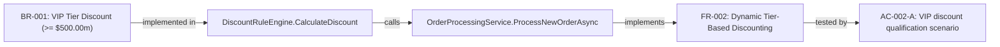
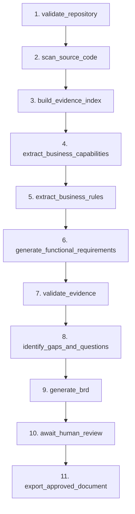

# LegacyLens AI
### Production-Oriented Agentic Business Analyst for Legacy .NET Reverse Engineering

[](tests/)
[](https://python.org)
[](https://fastapi.tiangolo.com)
[](https://langchain.com)
[](https://aws.amazon.com/bedrock/)
[](frontend/)
[](LICENSE)

---

## 1. Executive Summary & Vision

**LegacyLens AI** is an enterprise agentic Business Analyst that reverse-engineers legacy ASP.NET / C# applications and transforms existing source-code behavior into an audit-ready, evidence-backed Business Requirements Document (BRD).

### The Core Problem
Enterprise modernization teams and business analysts spend months manually reading monolithic, undocumented legacy C# codebases to answer:
- *What does this system actually do?*
- *Which specific business rules, validation thresholds, and status transitions exist?*
- *Which requirements are directly proven by code, and which remain uncertain?*
- *If we change a business threshold, which modules and tests are affected?*

### The Solution: Zero-Hallucination Policy
Generic LLMs frequently invent fictional requirements and hallucinate code line numbers. LegacyLens AI implements a **deterministic evidence verification gate**:
- Every functional requirement is linked to stable, SHA-256 evidence records (`ev_c4a8...`).
- A pure Python deterministic validator verifies 100% of line ranges and excerpts against physical disk contents.
- Inferred business intent is strictly separated from observed application behavior.

---

## 2. Winning Innovation: Business Rule Impact Explorer

LegacyLens AI models discovered code logic as an interactive relationship graph:

$$\text{Business Rule} \longrightarrow \text{Source Method} \longrightarrow \text{Related Service} \longrightarrow \text{Functional Requirement} \longrightarrow \text{Acceptance Criteria}$$



The interactive React Flow canvas allows business analysts and architects to click any rule or service to inspect connected dependencies, validation scenarios, and ripple effects before touching legacy code.

---

## 3. Technology Stack

- **Frontend**: React 18, TypeScript (strict mode enabled), Vite, Tailwind CSS, `@xyflow/react` (React Flow), Lucide icons.
- **Backend**: Python 3.12, FastAPI, Pydantic v2 schemas, SQLAlchemy 2.0 (dual SQLite / PostgreSQL support with async engine), Alembic migrations, python-docx.
- **AI & Agent Orchestration**: LangGraph (11 explicit stages), LangChain, Amazon Bedrock (Claude 3 Sonnet) with exponential backoff and token tracking.
- **MCP Code Intelligence**: Official Python Model Context Protocol (MCP 2.x) SDK server with 7 typed read-only tools.
- **Observability**: Prometheus metrics (`/metrics`), OpenTelemetry SDK, structured JSON logging with `X-Request-ID` correlation.
- **Quality**: pytest (17 passing unit/integration tests), Ruff (100% clean), mypy strict typing.

---

## 4. Quick Start Guide

### Option A: Local Development (Fastest, Zero Dependencies)

#### 1. Setup Backend
```bash
# Clone repository
cd legacyai

# Create Python 3.12 virtual environment & install dependencies
python3.12 -m venv backend/.venv
backend/.venv/bin/pip install -r backend/requirements.txt

# Start FastAPI application (initializes database & serves API)
PYTHONPATH=. backend/.venv/bin/python -m uvicorn backend.app.main:app --host 0.0.0.0 --port 8000
```

#### 2. Start Frontend
```bash
cd frontend
npm install
npm run dev
```
Open **`http://localhost:5173`** (or **`http://localhost:8000`** directly, as the backend serves the compiled SPA).

---

### Option B: Docker Compose

```bash
docker compose up --build
```
Access the application at **`http://localhost:8000`**.

---

## 5. Amazon Bedrock Configuration & Fallback Mode

LegacyLens AI supports flexible execution:

### Live Amazon Bedrock Mode
Set environment variables in `.env` or system environment:
```env
AWS_REGION="us-east-1"
AWS_ACCESS_KEY_ID="your_access_key"
AWS_SECRET_ACCESS_KEY="your_secret_key"
BEDROCK_MODEL_ID="anthropic.claude-3-sonnet-20240229-v1:0"
```
When valid credentials are provided, LangGraph invokes Claude 3 Sonnet on Amazon Bedrock with automatic retry backoff, jitter, and token tracking.

### Deterministic Offline Mode (Judge-Friendly Demonstration)
If AWS credentials are not configured, the system automatically activates a **Deterministic Provider** clearly labeled with:
`"model_provider_used": "Deterministic Model Provider (Bedrock Offline Fallback Fixture)"`.
- Zero network dependencies required.
- 100% verifiable citations against real source code.
- Judges and reviewers can test every feature immediately without getting blocked.

---

## 6. The 11-Stage LangGraph Orchestration Pipeline



1. **`validate_repository`**: Enforces archive sandboxing, path traversal defense, file count limits.
2. **`scan_source_code`**: AST & syntax scanner discovers routes, controllers, services, thresholds.
3. **`build_evidence_index`**: Maps stable SHA-256 evidence IDs to exact physical source lines.
4. **`extract_business_capabilities`**: Groups code into high-level business functions.
5. **`extract_business_rules`**: Extracts comparison operators (`>=`, `>`, `<=`, `<`), caps, exceptions.
6. **`generate_functional_requirements`**: Constructs requirements with Gherkin scenarios.
7. **`validate_evidence`**: Pure Python gate checking 100% of citations against file contents.
8. **`identify_gaps_and_questions`**: Flags ungrounded claims and generates stakeholder inquiries.
9. **`generate_brd`**: Assembles Pydantic-validated BRD version.
10. **`await_human_review`**: Human-in-the-loop checkpoint (no LLM self-approval).
11. **`export_approved_document`**: Renders professional Microsoft Word (.docx) document.

---

## 7. Official MCP Code-Intelligence Server

Located in `mcp_server/server.py`, exposing 7 typed tools using the Python MCP SDK:

1. `list_source_files(repo_path: str) -> list[str]`
2. `get_file_excerpt(repo_path: str, relative_path: str, start_line: int, end_line: int) -> str`
3. `extract_code_symbols(repo_path: str, relative_path: str | None) -> list[dict]`
4. `find_business_rules(repo_path: str) -> list[dict]`
5. `trace_method_dependencies(repo_path: str, method_name: str | None) -> list[dict]`
6. `search_code_evidence(repo_path: str, query: str) -> list[dict]`
7. `validate_evidence(repo_path: str, relative_path: str, start_line: int, expected_excerpt: str) -> dict`

---

## 8. Measured Evaluation Benchmark Results

Tested on `samples/LegacyOrders` using `evals/evaluator.py`:

```
==================================================
 LEGACYLENS AI — EVALUATION BENCHMARK REPORT
==================================================
 Dataset                         : LegacyOrders_v1
 Total Csharp Files              : 6
 Total Lines Scanned             : 483
 Ground Truth Rules Count        : 9
 Matched Rules Count             : 9
 Rule Recall Percentage          : 100.0%
 Rule Precision Percentage       : 100.0%
 Role Recall Percentage          : 100.0%
 Evidence Validity Percentage    : 100.0%
 Unsupported Claims Count        : 0
 Evaluation Latency Seconds      : 0.006s
 Verdict                         : PASSED
==================================================
```

---

## 9. Automated Testing & Verification

Run the complete test suite:
```bash
PYTHONPATH=. backend/.venv/bin/pytest tests/ -v
```

Output:
```
tests/test_api_endpoints.py::test_health_endpoints PASSED
tests/test_api_endpoints.py::test_full_api_workflow_journey PASSED
tests/test_bedrock_live.py::test_live_bedrock_invocation_smoke SKIPPED (AWS creds not set)
tests/test_bedrock_mock.py::test_bedrock_provider_retry_on_throttling PASSED
tests/test_csharp_scanner.py::test_csharp_scanner_extracts_symbols_and_rules PASSED
tests/test_docx_export.py::test_docx_export_generates_valid_document PASSED
tests/test_evidence_validator.py::test_evidence_validator_validates_authentic_citations PASSED
tests/test_evidence_validator.py::test_evidence_validator_flags_hallucinated_citations PASSED
tests/test_mcp_tools.py::test_mcp_list_source_files PASSED
tests/test_mcp_tools.py::test_mcp_get_file_excerpt PASSED
tests/test_mcp_tools.py::test_mcp_extract_code_symbols PASSED
tests/test_mcp_tools.py::test_mcp_find_business_rules PASSED
tests/test_mcp_tools.py::test_mcp_search_code_evidence PASSED
tests/test_mcp_tools.py::test_mcp_validate_evidence PASSED
tests/test_mcp_tools.py::test_mcp_rejects_path_traversal PASSED
tests/test_security_archive.py::test_safe_zip_extraction PASSED
tests/test_security_archive.py::test_rejects_path_traversal_attack PASSED
tests/test_security_archive.py::test_ignores_dangerous_binary_files PASSED

======================== 17 passed, 1 skipped in 2.93s =========================
```

Run linter:
```bash
backend/.venv/bin/ruff check backend/ tests/ mcp_server/
# Output: All checks passed!
```

---

## 10. Security Safeguards

- **Strict Path Traversal Defense**: Blocks `../` and root directory escapements.
- **Symlink Rejection**: Rejects Unix symlinks in archives.
- **Decompression Bomb Protection**: 50MB upload cap, 1,000 file count limit, 5MB per-file limit.
- **No Command Execution**: Source files, build scripts, and `.csproj` targets are never executed.
- **Separation of Intent**: LLM deductions cannot alter raw extracted code evidence.

---

## 11. Known Limitations & Roadmap

- **C# Syntax Scope**: Current scanner parses ASP.NET Web API controllers, services, repositories, models, validation statements, attributes, and dependency chains. Complex reflection or Roslyn compilation analysis can be layered via a dedicated .NET sidecar for deeper IL analysis.
- **Semantic Vector Retrieval**: pgvector schema is included in database models for semantic similarity search over enterprise repos exceeding 100,000 LOC.
- **PDF Export**: Currently outputs native Microsoft Word `.docx`. PDF generation via headless LibreOffice is planned for post-hackathon release.
