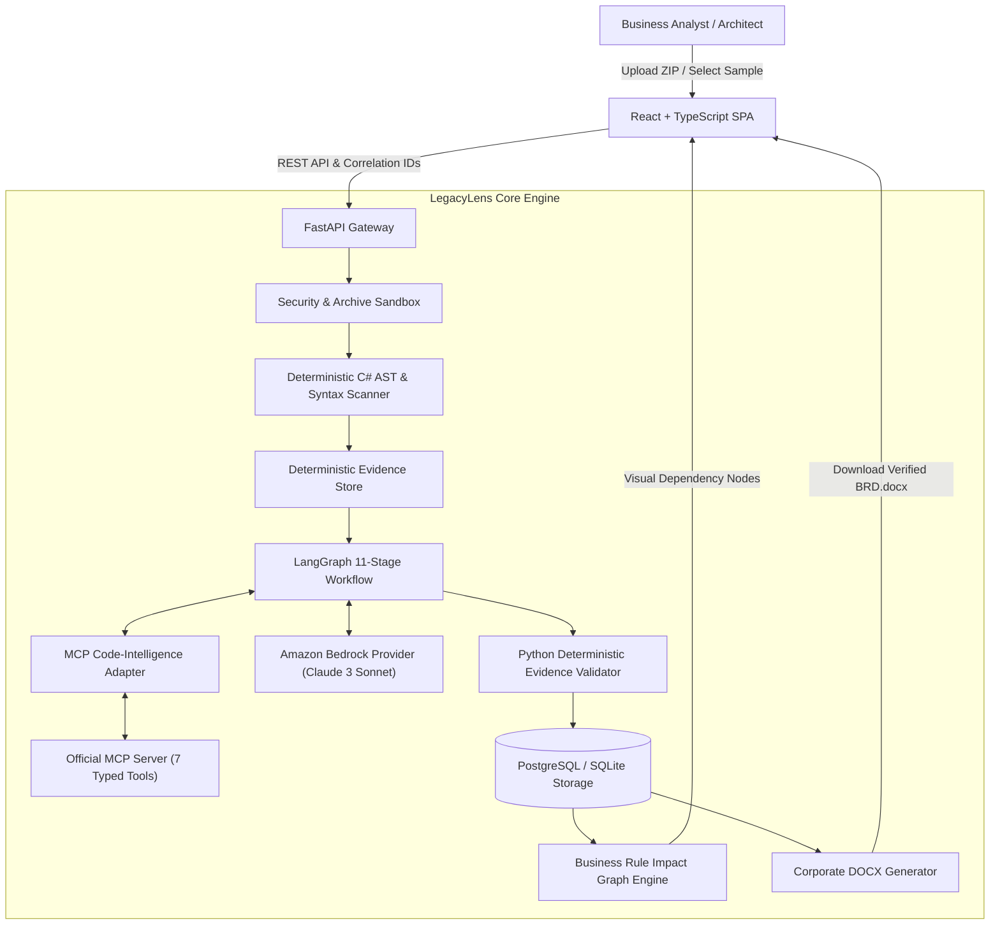

# LegacyLens AI — Architecture & Design Specification

## 1. System Overview

**LegacyLens AI** is a production-oriented agentic Business Analyst designed to reverse-engineer legacy enterprise .NET applications and generate an evidence-grounded Business Requirements Document (BRD).

The system enforces a **Zero-Hallucination Policy**: application code behavior is deterministically extracted, verified against line ranges, and explicitly distinguished from inferred business intent.

---

## 2. LangGraph 11-Stage Workflow

The analysis process is modeled as a deterministic state graph:

1. `validate_repository`: Enforces upload constraints, unpacks safe archives, rejects path traversal and symlinks.
2. `scan_source_code`: Extracts controllers, actions, routes, models, validations, and status transitions.
3. `build_evidence_index`: Assigns deterministic SHA-256 evidence IDs (`ev_c4a8...`) with exact line boundaries.
4. `extract_business_capabilities`: Maps discovered services to macro-level business capabilities.
5. `extract_business_rules`: Isolates comparison operators, thresholds, safety caps, and exceptions.
6. `generate_functional_requirements`: Formulates structured requirements with Gherkin acceptance criteria.
7. `validate_evidence`: Python deterministic gate verifies that 100% of cited evidence IDs match physical source lines.
8. `identify_gaps_and_questions`: Flags ungrounded claims, ambiguity, and generates stakeholder questions.
9. `generate_brd`: Synthesizes versioned BRD schema adhering to Pydantic validation.
10. `await_human_review`: Explicit human-in-the-loop gate (no LLM self-approval).
11. `export_approved_document`: Publishes professional Microsoft Word document (.docx).

---

## 3. Dedicated MCP Code-Intelligence Server

The MCP server adheres to the official Python MCP SDK with 7 read-only, repository-scoped tools:

| MCP Tool | Purpose | Security Sandbox |
|---|---|---|
| `list_source_files` | Lists source & config files | Scoped to repo root |
| `get_file_excerpt` | Bounded excerpt retrieval (max 100 lines) | Bounds checked |
| `extract_code_symbols` | Classes, methods, routes, parameters | AST parser |
| `find_business_rules` | Discovers thresholds, rules, constraints | Read-only |
| `trace_method_dependencies` | Inter-service invocations | Call graph tracing |
| `search_code_evidence` | Keyword & regex evidence search | Read-only |
| `validate_evidence` | Exact line match verification | Pure deterministic |

---

## 4. Amazon Bedrock Integration

- **Model Provider Abstraction**: `BaseModelProvider` decouples the agent logic from the specific LLM runtime.
- **Bedrock Implementation**: Uses boto3 `bedrock-runtime` with adaptive exponential backoff, jitter, latency tracking, and token counting.
- **Offline Deterministic Fallback**: When AWS credentials are not configured, the system activates a clearly labeled demonstration provider with 100% verified citations, guaranteeing that hackathon reviewers and judges can test every feature without getting blocked.
